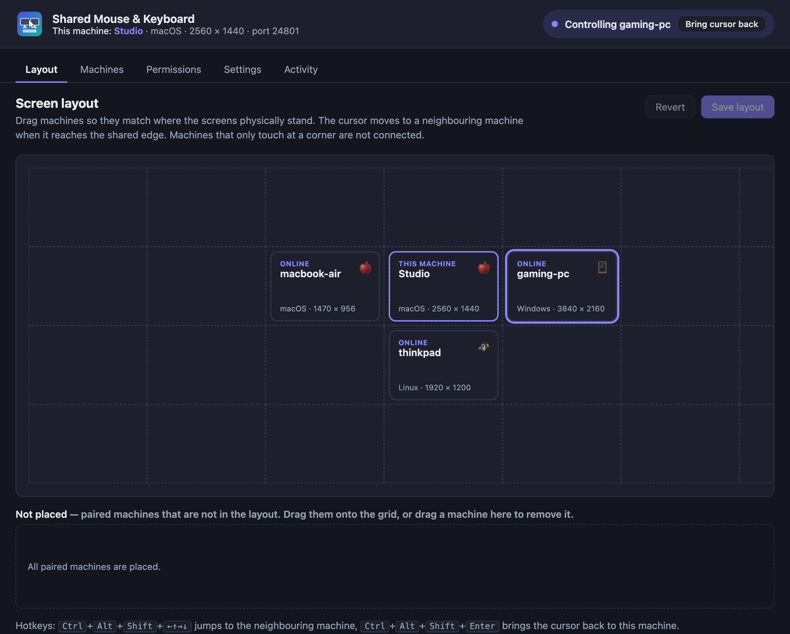
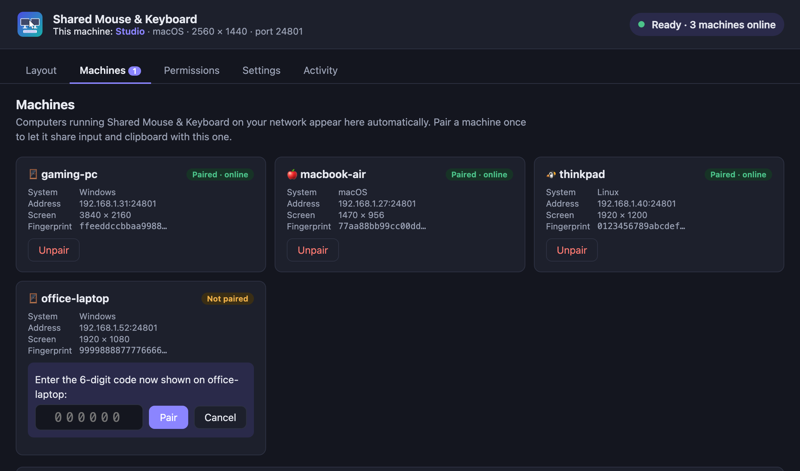
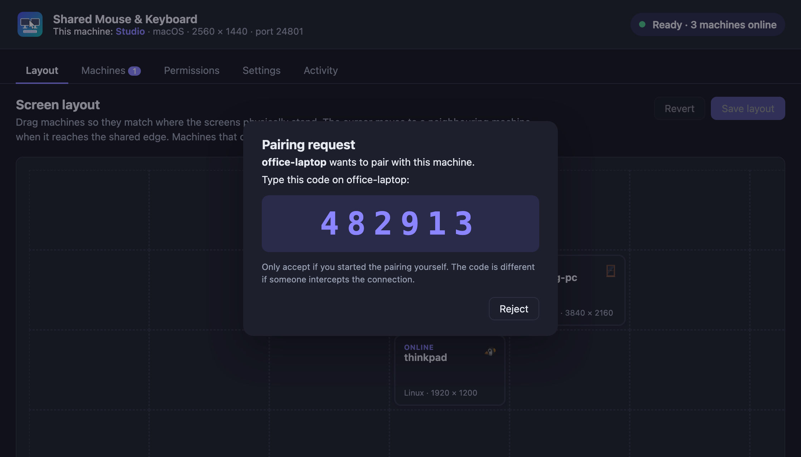
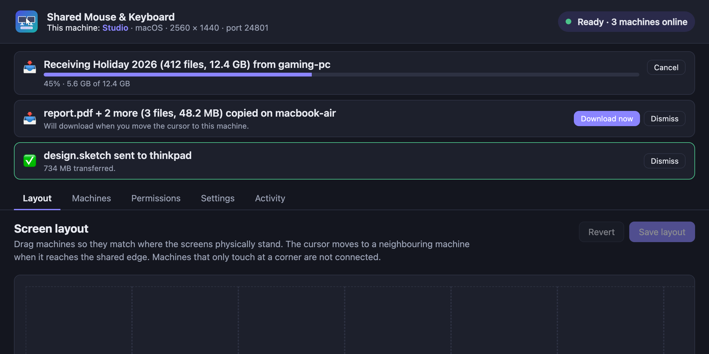
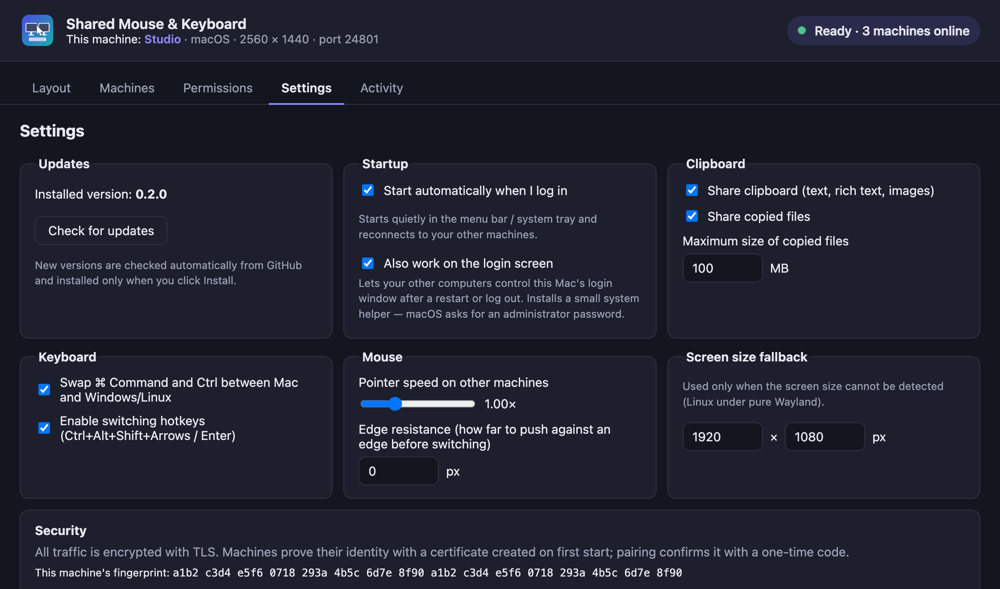
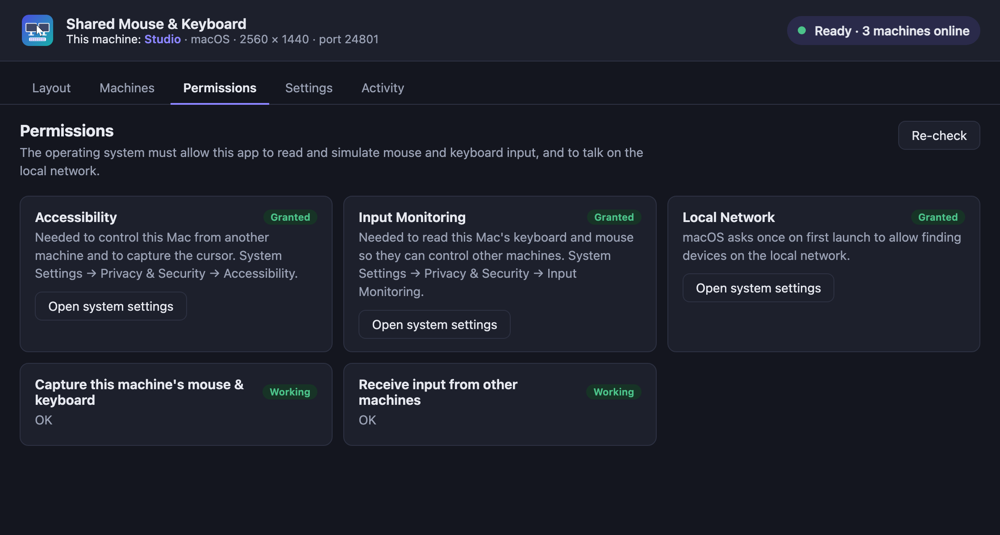

# Shared Mouse & Keyboard

[](https://github.com/hatak30/shared-mouse-keyboard/releases/latest)
[](https://github.com/hatak30/shared-mouse-keyboard/actions/workflows/ci.yml)
[](#download)

Use one mouse and keyboard to control several computers on your local network, and share the clipboard (text, rich text, images and **files**) between them. Works across **macOS, Windows and Linux** in any mix.

- **Seamless cursor movement.** Push the cursor against a screen edge and it continues on the neighbouring machine.
- **Visual layout editor.** Drag machines on a grid to match where your screens physically stand (left, right, above, below).
- **Clipboard sharing.** Copy on one machine and paste on another: text, rich text, images, and **files and folders of any size**, streamed in the background with progress and a Cancel button.
- **Secure by default.** All traffic is encrypted with TLS. Each machine is paired once with a 6‑digit code.
- **Automatic discovery.** Machines on the same LAN find each other. You can also add one manually by IP or host name.
- **Standalone app.** One self-contained app per OS. It keeps running in the system tray when its window is closed.

## Download

### ⬇️ [Get the latest version](https://github.com/hatak30/shared-mouse-keyboard/releases/latest)

On the release page, open **Assets** and pick the file for your system:

| System | File to download | |
|---|---|---|
| **macOS** (Apple Silicon and Intel) | `Shared.Mouse.Keyboard_X.Y.Z_universal.dmg` | Open it and drag the app to Applications |
| **Windows** 10/11 | `Shared.Mouse.Keyboard_X.Y.Z_x64-setup.exe` | Run the installer (the `.msi` works too) |
| **Linux** Debian/Ubuntu | `Shared.Mouse.Keyboard_X.Y.Z_amd64.deb` | `sudo apt install ./Shared.Mouse.Keyboard_*.deb` |
| **Linux** Fedora/openSUSE | `Shared.Mouse.Keyboard-X.Y.Z-1.x86_64.rpm` | `sudo dnf install ./Shared.Mouse.Keyboard-*.rpm` |
| **Linux** any distribution | `Shared.Mouse.Keyboard_X.Y.Z_amd64.AppImage` | `chmod +x` it and run; updates itself |

You only download it once: the app checks GitHub for new versions and offers **Install & restart**. All previous versions are on the [Releases page](https://github.com/hatak30/shared-mouse-keyboard/releases). New to the app? See [Getting started](#getting-started).

## Screenshots

**Layout editor.** Drag machines to match your desk. The highlighted machine is the one currently receiving your mouse and keyboard.



| Machines and pairing | Pairing code |
|---|---|
|  |  |
| **Copying files: progress and cancel** | |
|  | |
| **Settings** | **Permissions** |
|  |  |

## How it works

Every machine runs the same app. Whichever machine you're physically using captures its mouse and keyboard with OS-level hooks. When the cursor crosses an edge that has a neighbour in the layout, the app keeps the local cursor in place and streams input to the neighbour, which replays it as synthetic input. Moving back across the edge returns control. Any machine can be the controlling one.

```
┌──────────────┐  TLS (port 24801)  ┌──────────────┐
│   macOS      │ ◄────────────────► │   Windows    │
│  (keyboard,  │   input events,    │              │
│   mouse)     │   clipboard,       │              │
└──────────────┘   layout sync      └──────────────┘
        ▲      UDP broadcast discovery (port 24800)
        └──────────────────────────────► Linux …
```

| Component | macOS | Windows | Linux |
|---|---|---|---|
| Capture | `CGEventTap` | `WH_MOUSE_LL` / `WH_KEYBOARD_LL` hooks | `evdev` (+ `EVIOCGRAB`) |
| Injection | `CGEventPost` | `SendInput` | `uinput` virtual devices |
| Cursor position | CoreGraphics | Win32 | X11 (see Wayland notes) |
| Clipboard | NSPasteboard | Win32 clipboard | X11 / Wayland (`wl-clipboard`) |

Keys are sent in a neutral format (Linux evdev key codes), so a key pressed on one OS arrives as the same key on another. When a Mac controls a Windows or Linux machine (or the reverse), **⌘ Command and Ctrl are swapped**, so ⌘C becomes Ctrl+C. You can turn this off in Settings.

## Getting started

1. [Download](#download) and start the app on every computer.
2. Grant the permissions shown on the **Permissions** tab (details below).
3. Open the **Machines** tab. Your other computers appear within a few seconds. Click **Pair** on one of them.
4. The other computer shows a 6‑digit code. Type it into the first one. You only need to do this once per pair of machines.
5. Open the **Layout** tab, drag the machines to match your desk, and click **Save layout**. The layout is shared with every paired machine.

**Busy networks.** Every machine on the network that runs the app appears in **Machines**. Use the search box and the *All / Paired / Not paired* filter to find the right one. To stop a machine from bothering you, click **Block** on it, or **Block machine** in its pairing request. Its requests are then declined automatically, and it is hidden from the list (unblock it at the bottom of the tab). You can also turn off **Settings → Pairing → Allow other machines to send pairing requests**. You can still pair by clicking **Pair** on this machine.

Machines only work together once they are paired, so separate groups on the same network (A with B and C, X with Y and Z) stay independent. Don't pair one machine into two groups, or their layouts will overwrite each other.
6. Move the cursor off the shared edge to switch machines.

### Hotkeys

| Shortcut | Action |
|---|---|
| <kbd>Ctrl</kbd>+<kbd>Alt</kbd>+<kbd>Shift</kbd>+<kbd>←</kbd>/<kbd>→</kbd>/<kbd>↑</kbd>/<kbd>↓</kbd> | Jump to the neighbouring machine in that direction |
| <kbd>Ctrl</kbd>+<kbd>Alt</kbd>+<kbd>Shift</kbd>+<kbd>Enter</kbd> | Bring the cursor back to the machine you're using |

The tray menu also has **Return cursor to this machine**.

## Copying files and folders

1. Copy files or folders as usual (⌘C / Ctrl+C in Finder, Explorer or your file manager). Only the **list** of items (names and sizes) is sent to your other machines. **Nothing is transferred yet**, even when you move the cursor over.
2. Paste on the machine where you want them (⌘V on a Mac, Ctrl+V on Windows/Linux). The app holds that keystroke back and fetches the files over a **separate** encrypted connection, so the mouse and keyboard stay responsive:
   - **In a Finder window (macOS):** the files are saved straight into that folder, including on an external disk. The first time, macOS asks to let the app control Finder; this is how it learns which folder you're pasting into.
   - **Anywhere else:** the files are fetched to a temporary folder, put on the clipboard, and pasted automatically when the download finishes, if the same app is still in front.
3. To choose a folder instead, use **Save to…** in the control panel or **Save copied files to…** in the menu bar / tray menu.

While a copy runs, its percentage is shown next to the menu bar icon (macOS/Linux) and in the tray tooltip (Windows). The tray menu has **Cancel copy**, and notifications tell you when a large copy starts, finishes or fails. The control panel shows speed and time left, and **Show in Finder** when done.

- **No size limit.** Files are streamed straight to disk in chunks, so memory use stays flat. The only check is free space on the disk they're saved to.
- Existing files are never overwritten: a clash becomes `name 2.ext`.
- Folder structure, empty folders and modification times are kept. Symbolic links are skipped.
- Copying something new drops files that haven't been pasted yet. A copy that's already running keeps going. Cancelling removes partial files.
- Only the ⌘V / Ctrl+V keys are caught, not **Edit → Paste** from a menu or right-click. Use **Save to…** or **Fetch to clipboard** for those cases. On Linux, only a paste coming from another machine's keyboard is caught; on that machine's own keyboard, use the menu.
- Files fetched to the clipboard live in the app's cache folder (`~/Library/Caches/shared-mouse-keyboard/clipboard` on macOS). The last few are kept, and older ones are deleted automatically.

## Permissions

The app checks these at runtime and explains each one on the Permissions tab.

### macOS
- **Accessibility.** Required to capture the cursor and to be controlled by other machines. Go to System Settings → Privacy & Security → Accessibility.
- **Input Monitoring.** Required to read the keyboard and mouse. Go to System Settings → Privacy & Security → Input Monitoring.
- **Local Network.** macOS asks on first launch (macOS 15+). If you declined, go to System Settings → Privacy & Security → Local Network.
- The firewall may also ask whether to accept incoming connections. Click **Allow**.
- **Handoff (recommended off).** If your Macs share an Apple ID, Handoff's Universal Clipboard also shares the clipboard. It downloads things copied on another Mac by itself (you see "Pasting from …"), even when nobody pasted. The Permissions tab shows whether it is on and has a **Turn off Handoff** button (or go to System Settings → General → AirDrop & Handoff). The app never reads clipboard items that came through Handoff.

> macOS ties these permissions to the app's code signature. Build with `scripts/build-macos.sh` (`--install` also copies the app to /Applications and launches it). It signs with the first **Developer ID Application** certificate in your keychain, which keeps permissions across updates. Ad-hoc signed builds (no certificate) lose them on every rebuild. Set `APPLE_ID`, `APPLE_PASSWORD` (app-specific password) and `APPLE_TEAM_ID` to notarize as well, so other Macs open the app without a Gatekeeper warning.

### Windows
- **Firewall.** Windows asks on first start. Allow access on **private** networks.
- **Administrator (optional).** Windows blocks synthetic input to elevated windows (Task Manager, installers, UAC prompts) unless the app itself runs as administrator. The secure desktop (UAC prompt, lock screen) can never be controlled remotely.

### Linux
- **Read input devices.** Run `sudo usermod -aG input $USER`, then log out and back in.
- **Create virtual devices** (`/dev/uinput`). Install the udev rule. The `.deb` package does this automatically.
  ```sh
  sudo cp packaging/linux/60-shared-mouse-keyboard.rules /etc/udev/rules.d/
  echo uinput | sudo tee /etc/modules-load.d/shared-mouse-keyboard.conf
  sudo modprobe uinput && sudo udevadm control --reload && sudo udevadm trigger
  ```
- **Wayland.** Input capture and injection work on both X11 and Wayland, because they go through the kernel. Under a pure Wayland session, however, apps can't read the global cursor position, so switching by pushing against an edge isn't available there. Use the hotkeys, or log in with an X11 session. The clipboard works on both.

## Network

| Port | Protocol | Purpose |
|---|---|---|
| 24800 | UDP | Discovery beacons (broadcast) |
| 24801 | TCP | Encrypted connection between machines |

Machines must be able to reach each other on these ports. If broadcast is blocked (common on guest or corporate Wi‑Fi), add the other machine by address on the Machines tab.

## Security model

- Each installation generates a private key and a self-signed certificate on first start. They're stored in the config directory, and the key file is readable only by the user.
- Every connection is TLS 1.2/1.3 with mutual authentication, so both sides prove they hold their private key.
- Pairing derives a 6‑digit code from **both** certificate fingerprints. The code is shown on one machine and typed into the other. If someone intercepts the connection, the fingerprints differ, the code doesn't match, and pairing fails. After 3 wrong attempts, pairing is cancelled.
- Unpaired machines can only exchange pairing messages. Input, clipboard and layout updates from them are ignored. Blocked machines (and every machine, when pairing requests are turned off) get the same "declined" answer, so a blocked machine can't tell it was blocked.
- Files received through the clipboard are written to a cache directory, and paths that try to escape it are rejected.

## Configuration

The app stores its settings and identity in:

| OS | Path |
|---|---|
| macOS | `~/Library/Application Support/shared-mouse-keyboard/` |
| Windows | `%APPDATA%\shared-mouse-keyboard\` |
| Linux | `~/.config/shared-mouse-keyboard/` |

Set `SMK_CONFIG_DIR` to use a different directory, for example to run two instances for testing. Set `RUST_LOG=debug` for verbose logs. Start with `--hidden` to go straight to the tray, which is useful for autostart.

## Building

Prerequisites: [Rust](https://rustup.rs) (stable) and the [Tauri system dependencies](https://tauri.app/start/prerequisites/) for your OS. Node.js is **not** needed, because the UI is plain HTML/CSS/JS.

```sh
cargo install tauri-cli --version "^2" --locked

# run in development
cargo tauri dev            # from app/  (or: cargo run -p shared-mouse-keyboard)

# build installers for the current OS
cd app && cargo tauri build
#   macOS  → target/release/bundle/macos/*.app, dmg/*.dmg
#   Windows→ target/release/bundle/msi/*.msi, nsis/*.exe
#   Linux  → target/release/bundle/deb/*.deb, appimage/*.AppImage, rpm/*.rpm
```

Linux build dependencies (Debian/Ubuntu):
```sh
sudo apt install libwebkit2gtk-4.1-dev libayatana-appindicator3-dev librsvg2-dev build-essential
```

GitHub Actions runs lint checks and tests on all three platforms for every push (`.github/workflows/ci.yml`).

### Releases and automatic updates

Installers for every platform are published on the [Releases page](https://github.com/hatak30/shared-mouse-keyboard/releases). The app checks GitHub for a newer release at startup and every 6 hours. When one exists, it shows **Version X is available → Install & restart**. You can also check by hand under **Settings → Updates**.

- Every update is verified against the public key built into the app (`plugins.updater.pubkey` in `app/tauri.conf.json`). Updates signed with a different key are rejected.
- macOS releases are signed with the same Developer ID, so Accessibility and Input Monitoring permissions survive updates.
- Windows updates run the installer in passive mode. On Linux, only the **AppImage** updates itself. `.deb`/`.rpm` installs need the new package installed manually.

To publish a version (maintainers):

```sh
scripts/release.sh 0.2.0     # bumps versions, commits, tags v0.2.0, pushes
```

`.github/workflows/release.yml` then builds and signs on macOS (universal), Windows and Linux. It publishes the release together with `latest.json`, which installed apps poll. The secrets it needs are listed at the top of the workflow. The update-signing key lives in `~/.tauri/shared-mouse-keyboard-updater.key` (with its `.password` file); back it up, because without it you can't ship updates to existing installs.

### Tests

```sh
cargo test --workspace
```

The integration test (`crates/smk-core/tests/two_peers.rs`) starts two engines that talk over real TLS on localhost. It covers pairing (including a wrong code and a rejected pairing), layout sync, edge switching with proportional entry position, input forwarding, and releasing held keys on return.

## Project layout

```
crates/smk-core/       core engine (no UI)
  src/engine.rs        connection management, switching logic, clipboard & layout sync
  src/net.rs           TLS transport, framing
  src/tls.rs           identity, certificate fingerprints, pairing codes
  src/discovery.rs     UDP broadcast discovery
  src/protocol.rs      wire messages
  src/layout.rs        grid layout & neighbour lookup
  src/keymap.rs        macOS / Windows ↔ evdev key code tables
  src/clipboard.rs     clipboard read/write incl. files
  src/permissions.rs   per-OS permission checks
  src/input/           capture & injection backends (macos.rs, windows.rs, linux.rs)
app/                   Tauri desktop app (control panel + tray)
  ui/                  control panel (HTML/CSS/JS)
packaging/linux/       udev rule and module config for uinput
```

## Known limitations / roadmap

- Pure Wayland: there is no edge switching (hotkeys only), because Wayland doesn't expose the cursor position.
- Dragging files or windows *across* machines isn't supported. Copy and paste instead.
- The local cursor isn't hidden while you control another machine on Windows/Linux. It stays parked in the centre of the screen.
- Linux touchpads: basic one-finger movement and physical clicks are forwarded. Tap-to-click and gestures are not.
- Planned: autostart option, per-edge offsets for screens of different sizes, multi-monitor dead-zone handling, and a clipboard-on-demand mode for very large files.

## License

MIT
